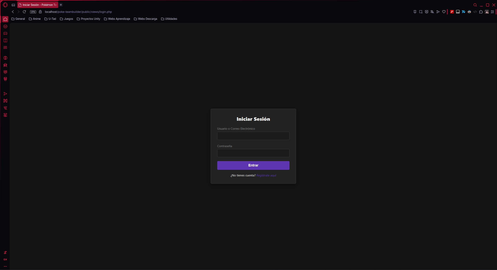
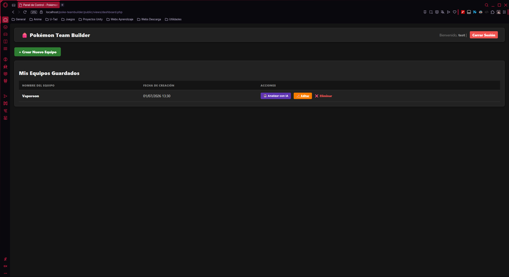
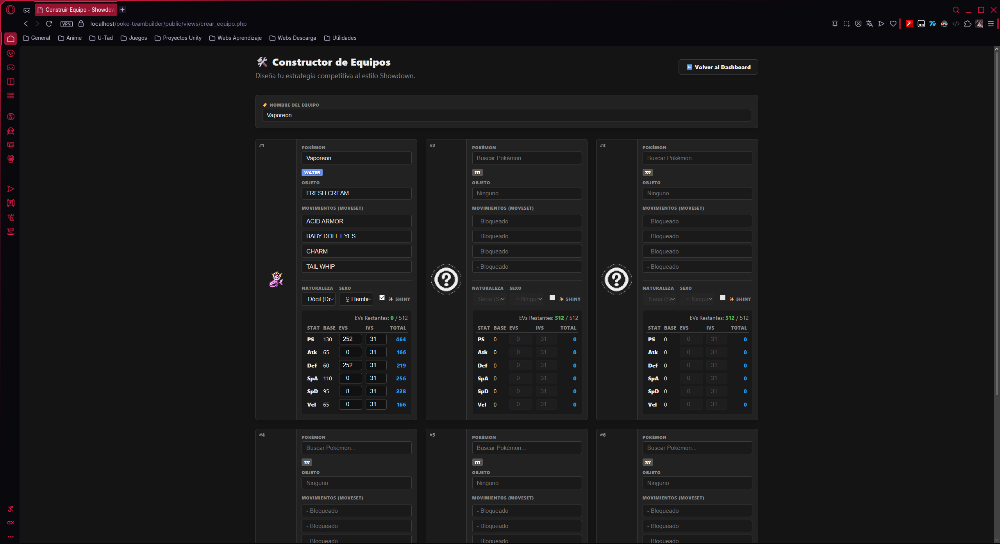

[English](README.md) · **Español**

# Pokémon Team Builder

Aplicación web en PHP/MySQL para crear, guardar y editar equipos Pokémon competitivos con una interfaz al estilo Showdown, usando datos en directo de [PokéAPI](https://pokeapi.co/).

Proyecto del curso de desarrollo web Full-Stack.

## Capturas

| Inicio de sesión | Panel |
|---|---|
|  |  |



## Funcionalidades

- Registro e inicio de sesión (contraseñas con bcrypt y consultas preparadas con PDO).
- Panel con tus equipos guardados: crear, editar y eliminar.
- Constructor de equipos con seis huecos. Cada hueco permite:
  - Buscar Pokémon con autocompletado sobre toda la Pokédex Nacional, con sprite, género y modo shiny.
  - Elegir objeto, habilidad y naturaleza.
  - Cuatro movimientos limitados a los que el Pokémon puede aprender legalmente en Escarlata/Púrpura.
  - Editor de EVs/IVs (252 por estadística, 508 en total) con cálculo de estadísticas finales en tiempo real.
- Las listas de PokéAPI (Pokémon, objetos, habilidades) se cachean en el navegador con IndexedDB para evitar peticiones repetidas.
- La interfaz está en español.

## Estado

- El botón «Analizar con IA» devuelve por ahora un texto de ejemplo. La integración con Gemini (`src/services/GeminiService.php`) aún no está implementada.

## Tecnologías

PHP 8 · MySQL / MariaDB (PDO) · JavaScript vanilla · HTML/CSS · PokéAPI

## Puesta en marcha

Requisitos: PHP 8+ con las extensiones `pdo_mysql` y `curl`, y MySQL o MariaDB.

1. Clona el repositorio.
2. Crea la base de datos importando el esquema:
   ```bash
   mysql -u root -p < docs/bd_schema.sql
   ```
3. Configura las credenciales de la base de datos en `config/config.php`.
4. Arranca el servidor de desarrollo:
   ```bash
   php -S localhost:8000 -t public
   ```
5. Abre `http://localhost:8000`, regístrate y crea tu primer equipo.

## Solución de problemas

Si la búsqueda de Pokémon no devuelve nada en Windows (XAMPP/WAMP), puede que PHP no tenga un paquete de certificados para las peticiones HTTPS. Descarga `cacert.pem` desde curl.se/docs/caextract.html, indica su ruta en `curl.cainfo` dentro de `php.ini` y reinicia el servidor.

## Estructura del proyecto

```
config/        conexión a la base de datos y ajustes
docs/          esquema, entregables del proyecto y capturas
public/        punto de entrada, vistas, CSS y JavaScript
src/models/    Usuario y Equipo (acceso a datos)
src/services/  SmogonService (consulta a PokéAPI), GeminiService (pendiente)
```

## Créditos

Los datos y sprites de Pokémon provienen de [PokéAPI](https://pokeapi.co/). Pokémon es una marca de Nintendo, Game Freak y Creatures Inc.; este es un proyecto de fans sin ánimo de lucro y sin afiliación.
