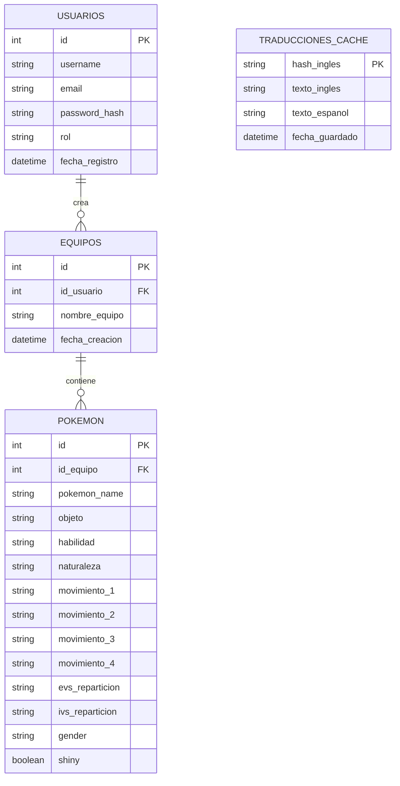

# Diseño de la Base de Datos y Modelo Entidad-Relación

Este documento detalla la arquitectura de persistencia de datos elegida para el proyecto **Pokémon Team Builder & Live Translator**. El diseño se ha estructurado utilizando el motor de bases de datos relacionales **MySQL / MariaDB**, garantizando la integridad referencial, la seguridad de acceso y la optimización del rendimiento en la integración con las APIs externas.

---

## 1. Diagrama Entidad-Relación (Mermaid)



## 2. Explicación y Lógica del Funcionamiento

El modelo se compone de cuatro entidades principales diseñadas bajo las reglas de normalización de bases de datos, resolviendo la lógica de negocio del entorno competitivo de Pokémon y el consumo eficiente de la API de Gemini:

- A. Gestión de Usuarios y Roles (`USUARIOS`)
  Propósito: Almacena las credenciales de acceso y determina los privilegios dentro de la aplicación web.

          - Seguridad: El campo `password_hash` se define con una longitud amplia para alojar los hashes generados mediante el algoritmo nativo de PHP 8 `password_hash()` (como Bcrypt o Argon2id), impidiendo el almacenamiento de claves en texto plano.

          - Control de Accesos: El atributo `rol` actúa como un enumerado práctico (`user`, `admin`). Permite que el backend restrinja rutas específicas para funciones administrativas (como auditoría del sistema o métricas globales).

- B. Estructura de Equipos (`EQUIPOS`)
    - Relación: Posee una relación 1 a Muchos (1:N) con la tabla `USUARIOS`. Un usuario puede diseñar múltiples configuraciones de equipos, pero cada equipo pertenece en exclusiva a su creador.

    - Contexto Competitivo: Guarda metadatos básicos del equipo como su nombre y fecha de creación. El proyecto se ha simplificado para centrarse en la construcción, edición y análisis del equipo sin depender de un formato de tier fijo.

- C. Configuración Técnica de Criaturas (`POKEMON`)
    - Relación: Mantiene una relación 1 a Muchos (1:N) con la tabla `EQUIPOS`. Cada equipo aloja un subconjunto de hasta 6 registros de Pokémon totalmente personalizados.

    - Decisión de Diseño (Optimización): En lugar de crear complejas tablas maestras e intermedias para los miles de movimientos, objetos y habilidades existentes en el juego, se optó por almacenar estos campos como cadenas de texto (`VARCHAR`). Dado que los datos ya vienen previamente validados y estructurados desde la API oficial de Smogon en el frontend, esta arquitectura evita un exceso innecesario de uniones (`JOINs`), acelerando drásticamente la velocidad de carga de un equipo completo.

    - Presentación Dinámica: El frontend consulta la PokéAPI para resolver sprites, variaciones shiny y diferencias por género. Cuando una especie no admite género o tiene un género fijo, el selector se bloquea automáticamente para evitar estados inválidos.

    - Exportación Estándar: Los campos `evs_reparticion` e `ivs_reparticion` guardan los valores en formato plano string (ej. `"252 Atk / 4 SpD / 252 Spe"`). Esto permite la compatibilidad directa con el formato "Import/Export" de herramientas líderes como Pokémon Showdown.

- D. Capa de Rendimiento y Ahorro de API (`TRADUCCIONES_CACHE`)
    - Propósito: Funciona de forma aislada al flujo principal como una capa de caché local.

    - Funcionamiento: Las peticiones de traducción de análisis competitivos con la IA de Gemini tienen un costo de tiempo de respuesta (latencia) y límites de cuota diarios. Cuando la aplicación solicita traducir un análisis de Smogon, el backend calcula un hash identificador único (MD5/SHA1) del texto original en inglés.

    - Flujo:
        1. Si el hash ya existe en `TRADUCCIONES_CACHE`, PHP sirve instantáneamente el texto en español desde la base de datos local en milisegundos.

        2. Si el hash no existe, se realiza la petición HTTP a la API de Gemini, se le entrega el resultado al usuario y simultáneamente se almacena en esta tabla para futuras consultas de cualquier otro usuario.

## 3. Sentencias SQL de Creación (DDL)

A continuación se detalla el script SQL estructurado para MySQL/MariaDB. Incluye la declaración explícita de claves primarias, foráneas, restricciones de unicidad y la configuración de eliminación en cascada (`ON DELETE CASCADE`) para mantener la base de datos limpia de registros huérfanos.

```sql
CREATE DATABASE IF NOT EXISTS poke_teambuilder DEFAULT CHARACTER SET utf8mb4 COLLATE utf8mb4_unicode_ci;
USE poke_teambuilder;

-- 1. Tabla de Usuarios
CREATE TABLE usuarios (
    id INT AUTO_INCREMENT PRIMARY KEY,
    username VARCHAR(50) NOT NULL UNIQUE,
    email VARCHAR(100) NOT NULL UNIQUE,
    password_hash VARCHAR(255) NOT NULL,
    rol ENUM('user', 'admin') NOT NULL DEFAULT 'user',
    fecha_registro DATETIME DEFAULT CURRENT_TIMESTAMP
) ENGINE=InnoDB;

-- 2. Tabla de Equipos
CREATE TABLE equipos (
    id INT AUTO_INCREMENT PRIMARY KEY,
    id_usuario INT NOT NULL,
    nombre_equipo VARCHAR(100) NOT NULL,
    fecha_creacion DATETIME DEFAULT CURRENT_TIMESTAMP,
    CONSTRAINT fk_equipos_usuarios
        FOREIGN KEY (id_usuario) REFERENCES usuarios (id)
        ON DELETE CASCADE ON UPDATE CASCADE
) ENGINE=InnoDB;

-- 3. Tabla de Detalles de Pokémon por Equipo
CREATE TABLE pokemon (
    id INT AUTO_INCREMENT PRIMARY KEY,
    id_equipo INT NOT NULL,
    pokemon_name VARCHAR(50) NOT NULL,
    objeto VARCHAR(50) DEFAULT NULL,
    habilidad VARCHAR(50) DEFAULT NULL,
    naturaleza VARCHAR(50) DEFAULT NULL,
    movimiento_1 VARCHAR(50) DEFAULT NULL,
    movimiento_2 VARCHAR(50) DEFAULT NULL,
    movimiento_3 VARCHAR(50) DEFAULT NULL,
    movimiento_4 VARCHAR(50) DEFAULT NULL,
    evs_reparticion VARCHAR(100) DEFAULT NULL,
    ivs_reparticion VARCHAR(100) DEFAULT NULL,
    gender VARCHAR(1) NOT NULL DEFAULT 'N',
    shiny TINYINT(1) NOT NULL DEFAULT 0,
    CONSTRAINT fk_pokemon_equipos
        FOREIGN KEY (id_equipo) REFERENCES equipos (id)
        ON DELETE CASCADE ON UPDATE CASCADE
) ENGINE=InnoDB;

-- 4. Tabla de Caché para el Traductor Gemini IA
CREATE TABLE traducciones_cache (
    hash_ingles CHAR(40) PRIMARY KEY, -- Optimizado para almacenar un hash SHA-1
    texto_ingles TEXT NOT NULL,
    texto_espanol TEXT NOT NULL,
    fecha_guardado DATETIME DEFAULT CURRENT_TIMESTAMP
) ENGINE=InnoDB;
```
