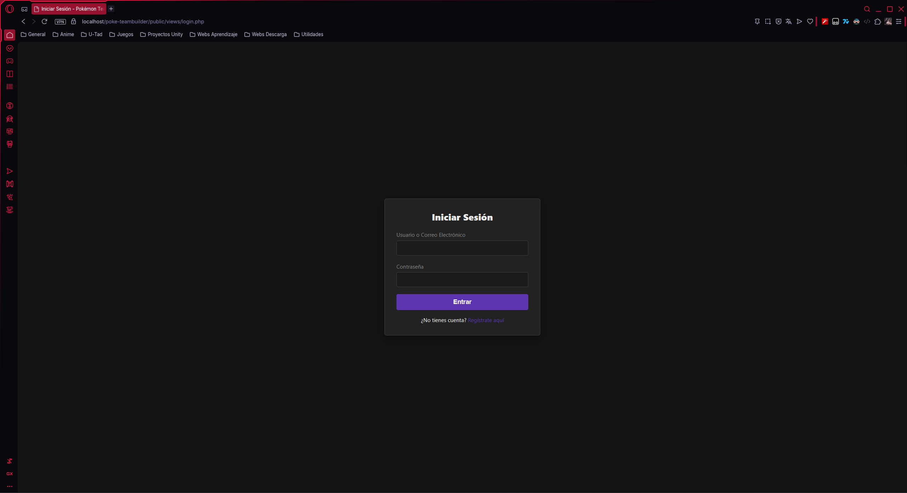
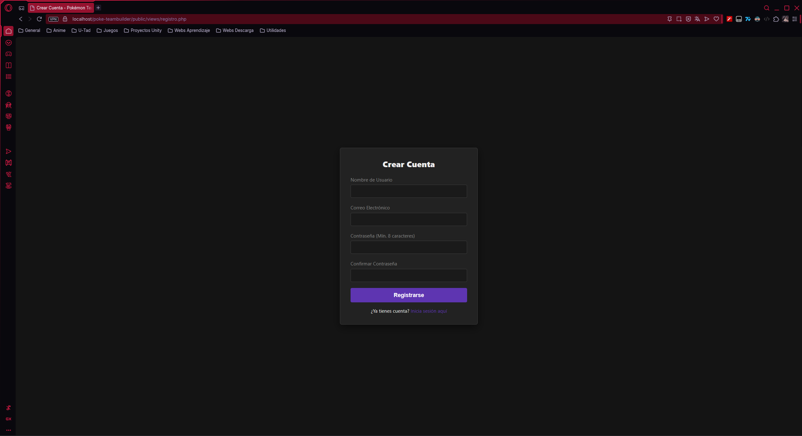
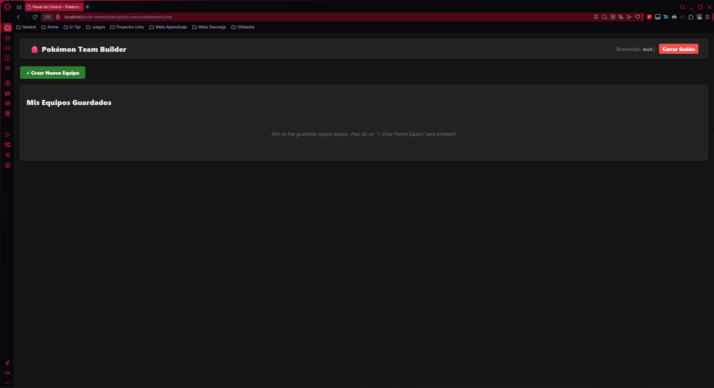
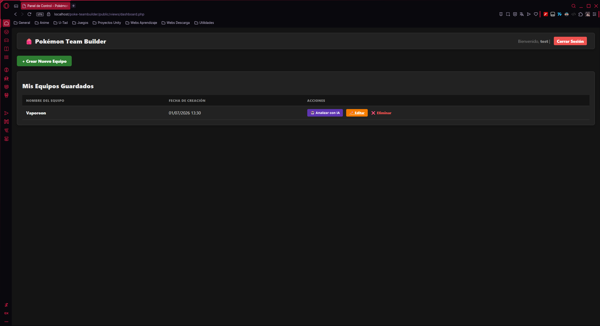
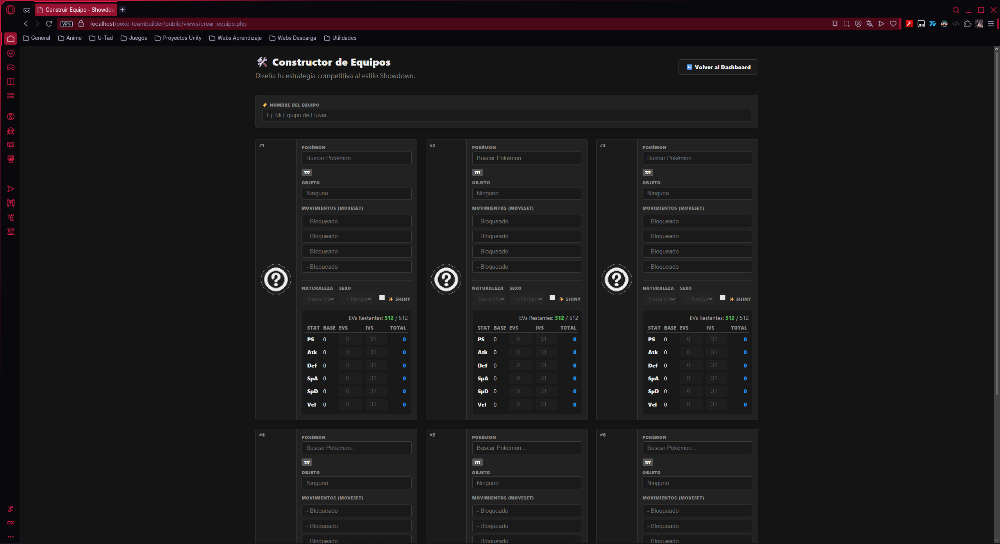
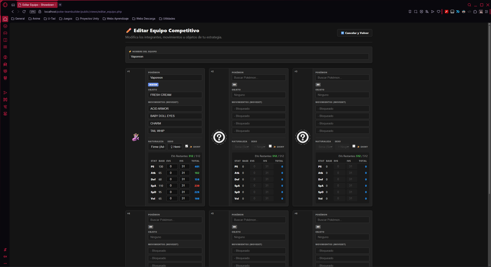
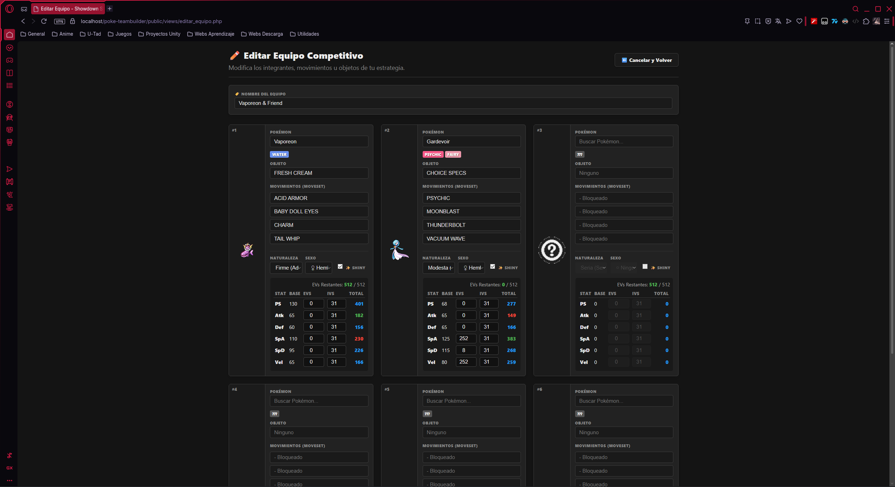
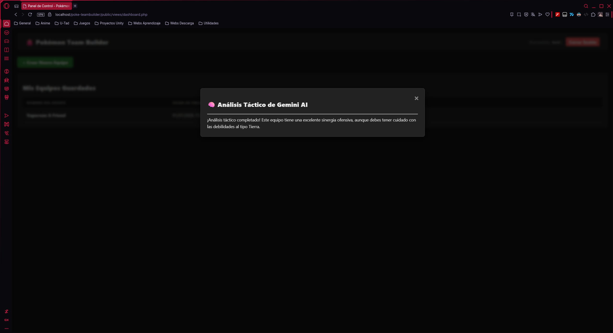

# Entregable 4 - Memoria Final y Presentación

## 1. Introducción

Este proyecto, **Pokémon Team Builder & Live AI Translator**, se ha desarrollado como una aplicación web académica para demostrar la aplicación práctica de los conocimientos adquiridos en desarrollo web, bases de datos, programación orientada a objetos, seguridad, diseño de interfaces y consumo de APIs externas.

La aplicación permite a un usuario autenticado construir y administrar equipos competitivos de Pokémon con una interfaz dinámica, persistencia en base de datos y funcionalidades apoyadas en servicios externos.

## 2. Objetivos

### Objetivo general

Desarrollar una solución web completa para la gestión de equipos competitivos de Pokémon con persistencia, autenticación y consumo de APIs externas.

### Objetivos específicos

- Implementar autenticación segura.
- Gestionar equipos competitivos desde una interfaz dinámica.
- Consultar APIs externas para enriquecer la experiencia de usuario.
- Almacenar datos de forma estructurada en MySQL/MariaDB.
- Aplicar validación, sanitización y control de acceso.

## 3. Tecnologías utilizadas

- **PHP 8.x**
- **MySQL / MariaDB**
- **HTML5**
- **CSS3**
- **JavaScript**
- **PDO** para acceso a base de datos
- **PokéAPI** para datos de especies, sprites y movimientos
- **PokéAPI** para búsqueda competitiva y autocompletado de especies
- **Google Gemini API** para análisis y traducción asistida

## 4. Diseño de la base de datos

La base de datos está formada por tablas para usuarios, equipos, Pokémon y caché de traducciones. El motor utilizado es **InnoDB** y se aplican claves primarias, foráneas y eliminación en cascada.

Documentación de referencia:

- `docs/bd_schema.sql`
- `docs/Entregable 2 - Diseño.md`

## 5. Explicación de funcionalidades

### 5.1 Autenticación

El sistema permite registro e inicio de sesión, con gestión segura de sesión y control de acceso a rutas privadas.

### 5.2 Dashboard

Muestra los equipos del usuario y permite operar sobre ellos.

### 5.3 Constructor de equipos

Permite:

- Seleccionar Pokémon mediante autocompletado.
- Buscar habilidades con autocompletado desplegable y normalización visual.
- Cargar sprites y tipos automáticamente.
- Gestionar objetos, movimientos, naturaleza, EVs, IVs, género y shiny.
- Recalcular stats de forma inmediata.

### 5.4 Edición de equipos

Los equipos guardados se pueden recuperar y modificar desde una interfaz equivalente al constructor.

### 5.5 Análisis asistido por IA

Existe una base para el análisis competitivo asistido por Gemini, pensada para ampliar la funcionalidad táctica del proyecto.

## 6. Capturas de pantalla

Las siguientes capturas reales se han incrustado como evidencia del flujo completo de la aplicación en su estado actual.

### Login

### Registro

### Dashboard

### Constructor de equipos

### Editor de equipos

### Análisis táctico

### Secuencia de uso

1. [Login](screenshots/captura-login.png)
2. [Registro](screenshots/captura-registro.png)
3. [Dashboard vacío](screenshots/captura-dashboard_empty.png)
4. [Dashboard con equipos](screenshots/captura-dashboard.png)
5. [Constructor vacío](screenshots/captura-builder_empty.png)
6. [Constructor con equipo](screenshots/captura-builder.png)
7. [Editor sin modificar](screenshots/captura-editor_unmodified.png)
8. [Editor con cambios](screenshots/captura-editor.png)
9. [Análisis táctico](screenshots/captura-analisis.png)

## 7. Problemas encontrados y soluciones

### Problema 1: Integración de datos dinámicos de sprites y género

**Solución:** se resolvió consultando PokéAPI para obtener sprites, diferencias de sexo y variantes shiny, y ajustando el frontend para bloquear el selector de género cuando corresponde.

### Problema 2: Recálculo manual de estadísticas

**Solución:** se modificó el flujo de carga para recalcular stats automáticamente al seleccionar un Pokémon.

### Problema 3: Persistencia de campos opcionales

**Solución:** se amplió el modelo de datos para almacenar género y shiny y se sincronizó el formulario con campos ocultos cuando el selector queda bloqueado.

### Problema 4: Integración parcial de IA

**Solución:** se dejó preparada la arquitectura de servicios y el endpoint de análisis para una integración completa con Gemini.

### Problema 5: Portabilidad de equipos entre herramientas externas

**Solución:** se documentó como vía futura la exportación e importación interoperable de equipos y Pokémon para mantener compatibilidad con Pokémon Showdown y otras webs alternativas.

## 8. Futuras vías de desarrollo

Aunque el proyecto ya cumple su objetivo principal, se pueden plantear varias mejoras para una evolución posterior:

- Integrar de forma completa el servicio de análisis con Gemini, sustituyendo la respuesta simulada por una salida real generada desde la API.
- Mover las claves sensibles de configuración a variables de entorno para reforzar la seguridad del despliegue.
- Añadir más formatos de equipo o reglas competitivas si se desea ampliar el alcance de la aplicación.
- Mejorar el sistema de análisis con métricas más profundas sobre cobertura, amenazas y sinergias del equipo.
- Incorporar persistencia más avanzada para campos competitivos adicionales como habilidad, EV spread o IV spread si se desea exportar el equipo con mayor fidelidad.
- Añadir exportación e importación de equipos y Pokémon en formatos compatibles con herramientas externas, como Pokémon Showdown o webs alternativas similares, para facilitar la portabilidad de estrategias.
- Refactorizar el servicio de búsqueda competitiva para eliminar nombres heredados y dejar la nomenclatura completamente alineada con PokéAPI.

## 9. Conclusiones

El proyecto cumple con los objetivos académicos propuestos porque integra frontend dinámico, backend en PHP 8, persistencia en MySQL/MariaDB, seguridad básica, validación y consumo de APIs externas. Además, la solución está estructurada de manera modular, lo que facilita su mantenimiento y evolución.

Como trabajo final, demuestra la capacidad de construir una aplicación web completa con lógica de negocio real, interacción con servicios externos y almacenamiento persistente de datos.

## 10. Sugerencias para la presentación

1. Explicar primero el problema que resuelve la aplicación.
2. Mostrar el modelo de datos y justificar la estructura elegida.
3. Demostrar el flujo de autenticación.
4. Mostrar la creación y edición de un equipo en directo.
5. Enseñar la carga automática de sprites y stats.
6. Cerrar con el análisis táctico y las posibilidades de ampliación.
